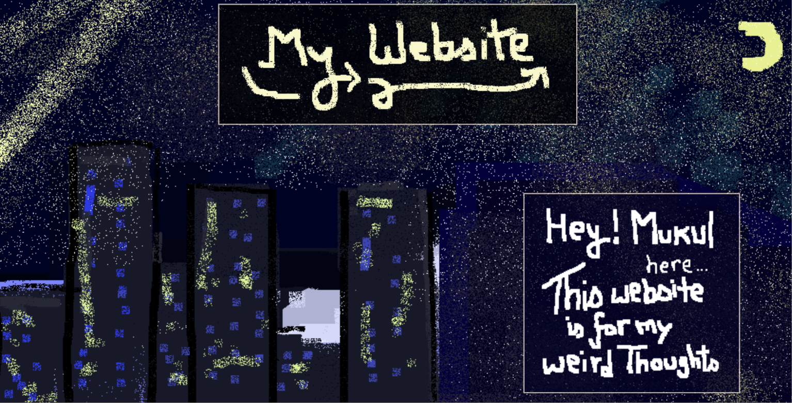
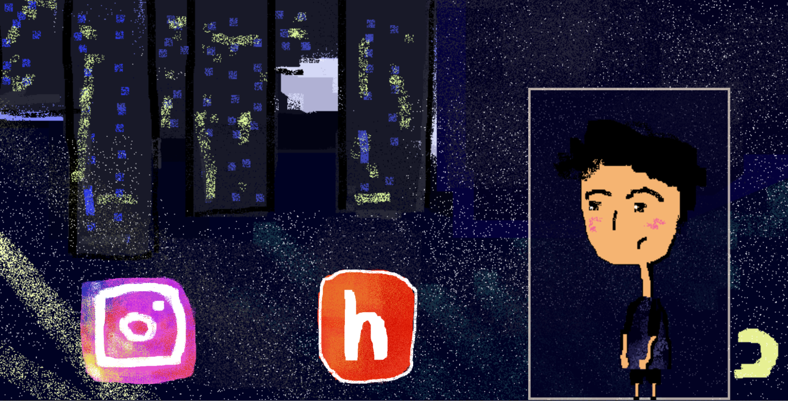
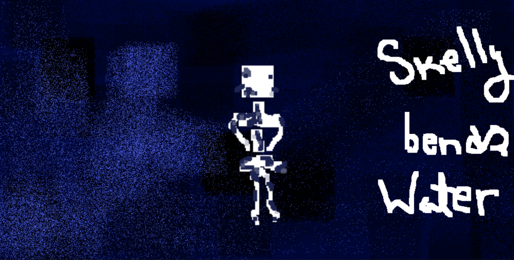
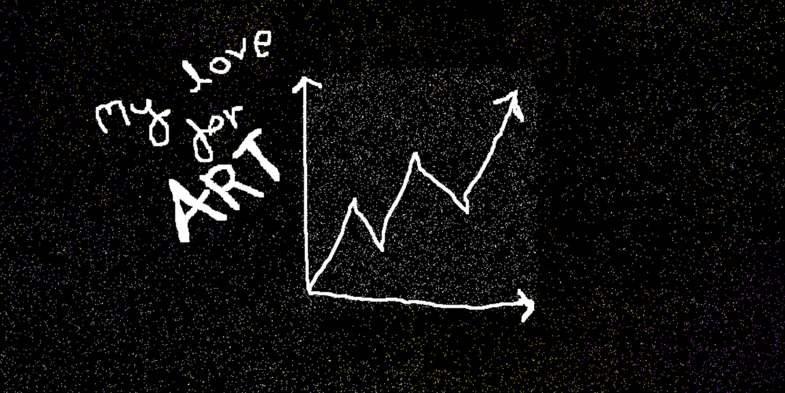
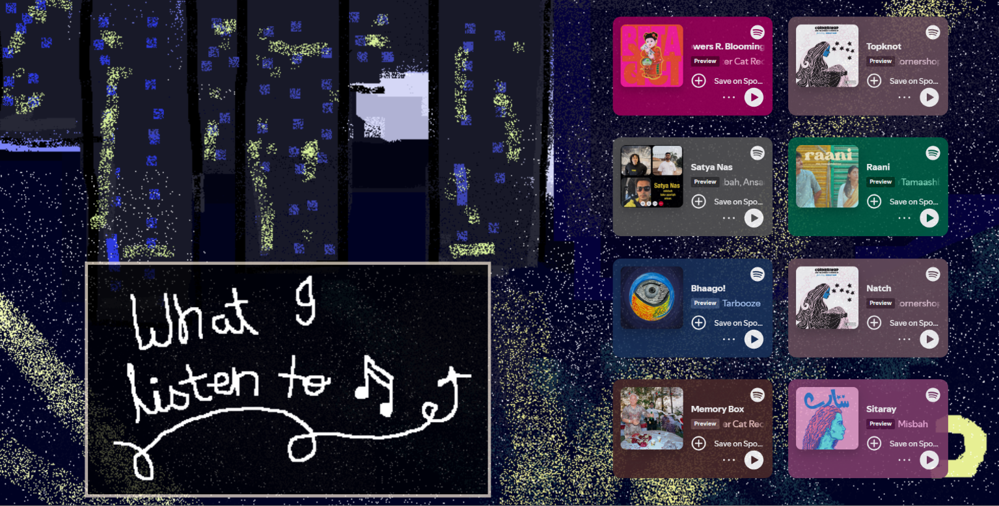

# My Website
**coded by: Mukul**

I have coded this personal website to show the weird thoughts i have and the music i listen to during them.

# My demo link
[https://mukul-mittal-art.github.io/My-website/](https://mukul-mittal-art.github.io/My-website/)


# Tech stack
Program used: Visual Studio Code, Pixeloroma
Languages used: CSS, HTML (lapse if it counts)

# What does it do?
makes me happy. (jk)
It's a project that shows my weird thoughts, for if someone is interested in them. I wanted to make this to learn new webdev mechanics and pixel art.

# How did i make it?
* I made a rough sketch on paper on how i want it to look.
* Then I made digital art on pixeloroma and recorded using lapse.
* I imported all artworks and necessary files and started coding.
* I added hover effects, animations and positioned my artworks.
* I worked section by section, gradually adding more assets.

# Problems i faced
* How to animate with images? (keyframes)
* How to position certain elements in a specific area? (div, relative and absolute position)
These were some of the major problems i faced, among countless minor ones that increased this project's worktime ;-;

# AI USAGE
Have i used AI? yes.
How much? only a little
On what? CSS

I used AI to help debug my code and teach me how to code animations and position certain elements.

# Screenshots






# How to run the project locally
Clone and run this repository:
```bash
git clone https://github.com/mukul-mittal-art/My-website.git